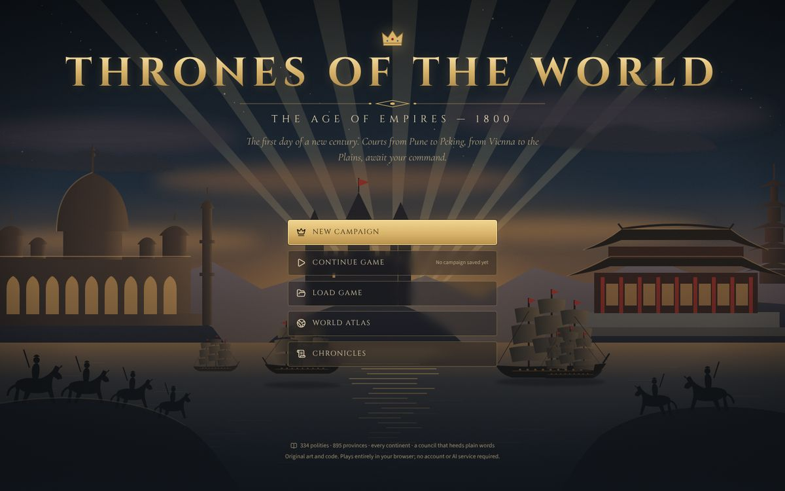
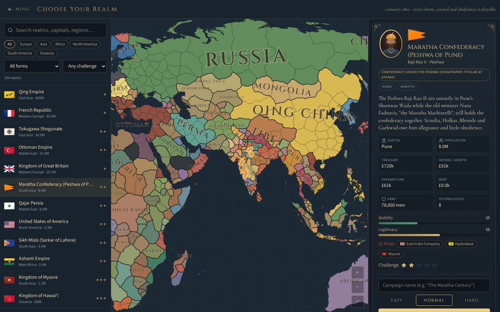
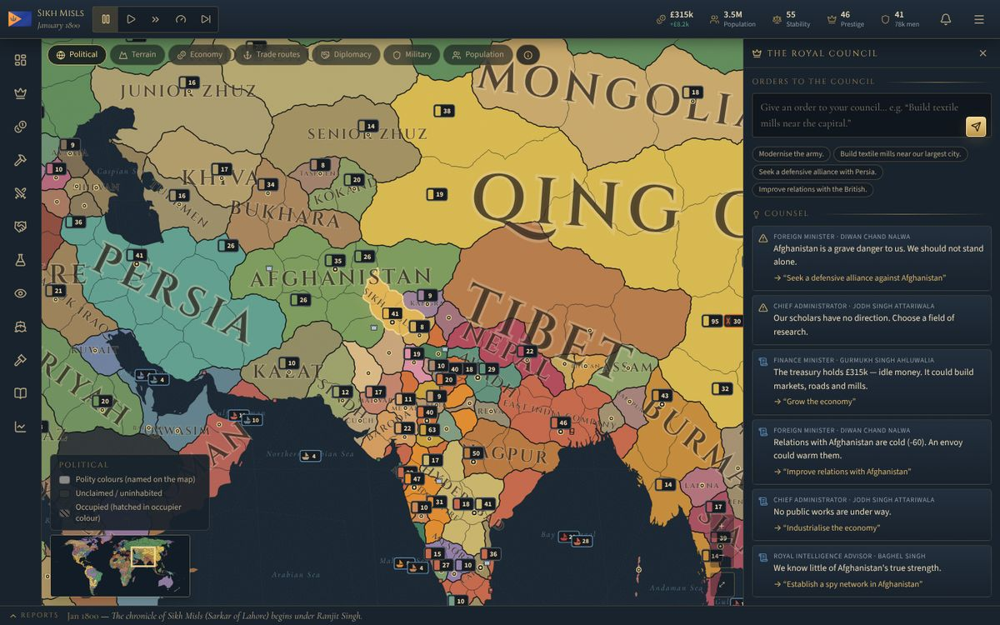
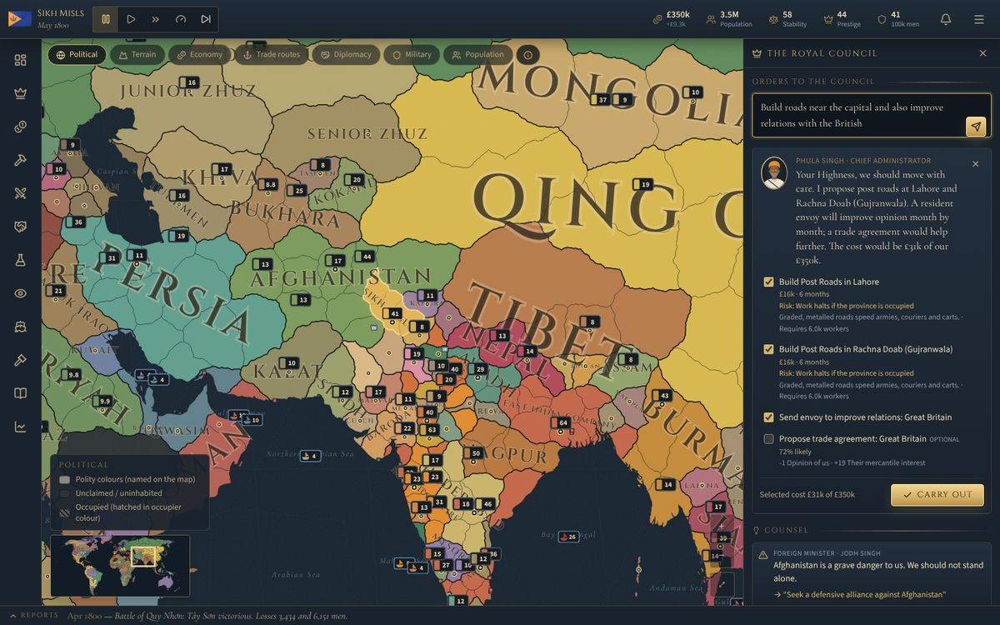
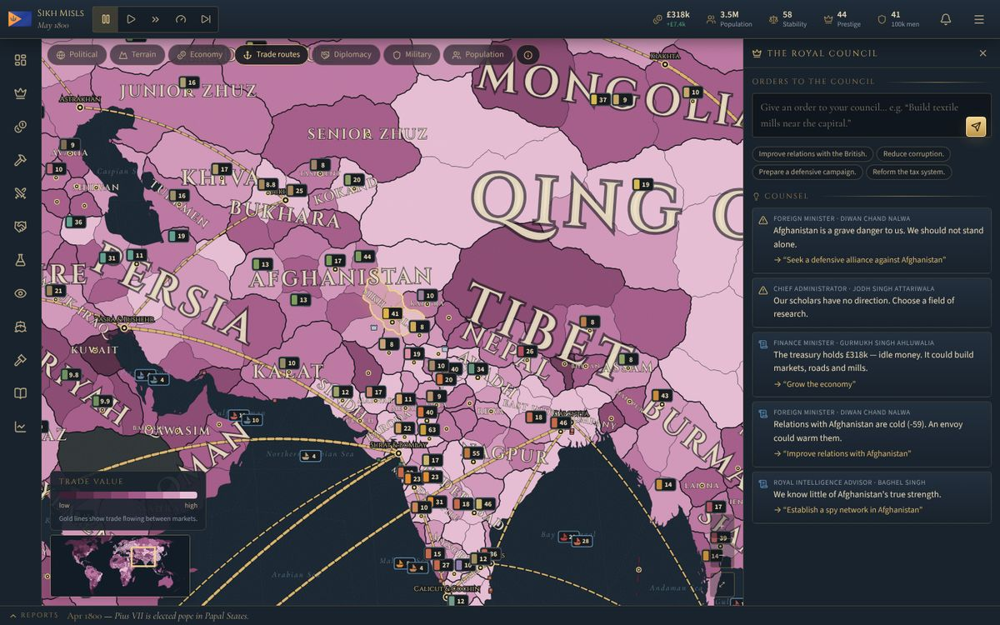

# Thrones of the World: 1800

*The Age of Empires — 1800.* A grand-strategy game that runs entirely in the browser. It is the first day of the nineteenth century: pick any of 294 playable realms (Maratha peshwas and Sikh misldars, Qing emperors and Tokugawa shoguns, the First Consul, Ottoman sultans, Asante kings, Haudenosaunee councils, Māori iwi and many more) and guide it through the decades that follow.



| Choosing a realm | In the game |
|---|---|
|  |  |
| **The royal council turns plain orders into costed plans** | **Trade-route layer** |
|  |  |

## Quick start

Requires Node.js 20.19+ or 22.12+ (Vite 8).

```bash
npm install
npm run dev          # http://localhost:5173
```

Production build and preview:

```bash
npm run build        # type-checks, then builds to dist/
npm run preview      # serves dist/ at http://localhost:4173
```

`dist/` is a static site (relative paths), so it can be hosted on any static file server.

### Tests

```bash
npm test             # 47 unit tests (vitest): economy, loans, construction, research,
                     # diplomacy, war, sieges, peace, saves, migrations, the council, a 3-year AI run
npm run build && npm run smoke
                     # end-to-end in headless Chromium: menu → realm → months → council →
                     # panels → map layers → fast play → save → reload → continue → atlas,
                     # desktop and phone viewports; fails on any page error
npm run smoke:mobile # phone-sized touch test: taps, drag-to-pan, pinch-to-zoom, army orders,
                     # the council drawer, panels, events, save, reload and continue
```

The smoke tests use `playwright-core` with an installed Chromium. Point it at one with `CHROME_PATH=/path/to/chrome` if it is not at the default location; screenshots go to `smoke-output/`.

Other scripts: `npm run typecheck`, and `npm run build:map`, which regenerates the map geometry (`src/data/generated/map.json`) from Natural Earth data and the province seeds.

## How to play

- **Time** starts paused. Play/pause with the buttons or <kbd>Space</kbd>; <kbd>1</kbd>–<kbd>3</kbd> set the speed; <kbd>N</kbd> advances one month. Events that need a decision pause the clock (configurable).
- **The map**: drag to pan, wheel or pinch to zoom, arrow keys and <kbd>+</kbd>/<kbd>−</kbd> also work. Click a province or army to select it. With one of your armies selected, right-click a province to march (or use *Move* on the army card, which works on touch screens). Overseas destinations are reached by convoy if a fleet with transports is nearby.
- **Layers**: political, terrain, economy, trade routes, diplomacy, military and population, each with a legend and hover tooltips. A minimap sits in the corner.
- **The royal council** (right-hand panel): type an order such as “Modernise the army”, “Build textile mills near Lahore”, “Seek a defensive alliance with Persia”, “Improve relations with the British”, “Reduce corruption”, “Prepare a defensive campaign” or “Reform the tax system”. The responsible minister answers in character and proposes concrete steps, each showing its cost, time, chance and risks. Nothing happens until you tick the steps you want and choose *Carry out*. Ministers also volunteer counsel when something needs attention.
- **Government** (left rail): Overview, Royal Court, Economy, Construction, Military, Diplomacy, Technology, Espionage, Trade, Laws & Reforms, Chronicles and Reports. On phones these sit in a bottom bar with a *More* sheet.
- **Saving**: the campaign autosaves every few months and whenever the tab is hidden or closed, so a refresh never loses progress. The menu (☰) offers named saves, loading, JSON export and import, and settings.

## What is in the game

**World.** 334 polities (294 playable; 38 loosely organised regions, such as the peoples of Amazonia or the Inuit communities, are shown as aggregates) on 895 provinces, with 124 sea zones, 42 trade markets and 35 European forts and factories abroad. Each polity carries its 1800 ruler and heir, capital, population, revenue, debt, army and navy, government, culture, religion, rivals and allies, technology profile, laws and an introduction. Colonies, chartered companies, tributaries, subsidiary allies, confederations and decentralised societies are all represented as such.

**Turn order (monthly).** Revenue and expenses → construction, research and recruitment → diplomacy, espionage and the AI → population, food, unrest and politics → movement, naval and land battles, sieges, attrition and rebellions → war scores → events → reports and chronicle.

**Economy.** Taxes on provincial output (scaled by administrative efficiency, corruption, unrest and occupation), a trade model in which wealth flows downstream through 42 markets and is shared by trade power, tariffs, tribute and subsidies, inflation, an economic cycle, food reserves and famine, world prices for 30 goods that react to supply and industrialisation, term loans and perpetual debt with interest set by creditworthiness, and bankruptcy. Starting budgets are calibrated so that 1800 revenues come out close to the historical scale (Britain about £3–4 million a month).

**Construction and industry.** 20 building types (roads, canals, harbours, dockyards, irrigation, granaries, markets, manufactories, textile mills, ironworks, mines, steam engine works, schools, universities, hospitals, courthouses, religious foundations, fortresses, barracks, arsenals) limited by money, a labour pool, technology and raw materials. Any realm can industrialise.

**Technology.** 63 technologies in ten fields with 1800 regional baselines. Costs fall as knowledge spreads through neighbours, trade partners and the wider world, and rise for anything ahead of its historical year.

**Politics.** Rulers, heirs and consorts who age, sicken and die; succession and regencies; a five-member council of ministers with personalities and skills; six court factions with influence and loyalty; legitimacy, stability, prestige and corruption; 37 laws in eight categories, enacted over months; unrest, revolts and rebel armies that can win their demands.

**War.** Infantry, cavalry, artillery and irregulars with terrain modifiers; generals; morale and experience; supply limits, seasonal and terrain attrition; battles with retreat and surrender; sieges with artillery and blockades; ships of the line, frigates and transports, naval battles, blockades and seaborne expeditions; war exhaustion, war score from occupation and battles, casus belli, allies and subjects called to arms, and negotiated peace (ceded provinces, reparations, tributary status or vassalage, humiliation, independence) with truces afterwards.

**Diplomacy and espionage.** Alliances, trade agreements, royal marriages, guarantees, non-aggression pacts, military access, tribute demands, subsidies, envoys, insults and peace congresses, each judged by the other court on opinion, interests and power. Spy networks, counter-intelligence, intelligence gathering, sabotage, incitement, technology theft, fabricated claims and bribery.

**AI.** Every non-player court manages its taxes, budget, debt, construction, research, recruitment, garrisons, alliances, wars and peace according to its personality (aggression, caution, diplomacy, mercantile and reforming bent) and its threats.

**Events.** 51 events that fire from the state of each realm rather than a timetable: successions, regencies, court intrigues, harvests and famines, epidemics, disasters, discoveries, industrial breakthroughs, revolutions, mutinies, ambitious generals and more. Historical pressures of 1800 (the Act of Union, the papal conclave, Nana Fadnavis's last years, Bonaparte's ambitions) are present as possibilities, not scripts, so history can diverge.

**Art.** Everything is original vector art drawn in code: the title panorama, flags for every polity (a small flag language plus hand-drawn specials), cameo portraits in 21 regional court styles, engraved event illustrations, seals, gilt ornaments and a compass rose. There are no external image files.

## The council and AI models

The council is a deterministic, rule-based interpreter (`src/game/advisor.ts`). It recognises intents (construction, recruitment, the navy, military reform, defence, diplomacy, war and peace, taxation, loans, laws, research, industrialisation, order, food, learning, espionage), resolves places and polities by name, adjective or common alias, and builds plans out of the same validated actions the interface uses. It cannot spend money twice, act on land it does not hold, or bypass a rule: every step goes through `previewAction()` and again through `applyAction()` when carried out.

Optionally, Settings → *AI council* lets you supply your own Anthropic API key so that a Claude model (`claude-opus-5-5`, via the official `@anthropic-ai/sdk`) interprets free-form orders. The model receives a compact description of the realm and may only answer with actions from a fixed JSON schema (structured output); the game then validates each proposal exactly as above and shows you the plan to approve. Refusals, errors and malformed answers fall back to the rule-based council. The key is stored only in your browser and sent only to `api.anthropic.com`; requests are billed to your account. The game is fully playable without it.

## Architecture

```
src/
  data/            the 1800 database: polities and provinces by region, seas, trade markets,
                   outposts, technologies, buildings and units, laws, names, scenario setup;
                   generated/map.json (province shapes, adjacency, coasts, ports, sea zones)
  game/            the simulation, framework-free TypeScript
    types.ts         world state (everything that is saved)
    create.ts        builds the January 1800 world
    turn.ts          the monthly turn
    economy.ts  construction.ts  tech.ts  society.ts  military.ts  naval.ts
    war.ts  diplomacy.ts  espionage.ts  ai.ts  characters.ts
    events/          event definitions, effects and engine
    actions.ts       validated actions with previews (costs, risks, consequences)
    advisor.ts       the royal council: order interpreter and counsel
    save.ts          versioned saves, migrations, validation, compression, slots, export
    rng.ts           seeded random numbers (state is saved, so campaigns are reproducible)
  advisor/llm.ts   optional Claude interpretation of orders
  store/           zustand store; the simulation runs in a Web Worker (simWorker.ts)
  map/             the SVG world map, layers and label placement
  art/             flags, portraits, title scene, event illustrations, ornaments
  screens/         menu, realm selection, game screen, archive, atlas, chronicles
  panels/          the twelve government panels
  ui/              shared components, formatting, chart
scripts/
  build-map.ts     map generator (Natural Earth land → provinces, borders, seas, adjacency)
  smoke.mjs        browser end-to-end test
tests/             vitest unit tests
```

The simulation mutates one plain-object world in place and is deterministic for a given seed. The interface sends the world to a Web Worker for each month (falling back to the main thread if workers are unavailable) and receives the advanced world back, so the map stays responsive; a month takes roughly 150–250 ms. Pan and zoom update an SVG transform directly rather than re-rendering React, and labels and markers change level of detail when a gesture settles.

Saves are JSON (numbers rounded to four decimals), compressed with lz-string into `localStorage`, roughly 200–400 KB each. Every save carries a schema version; older saves are migrated on load and invalid ones are rejected with a readable message.

## Historical data and honest limits

The database aims to be plausible and date-specific for 1 January 1800 rather than exhaustive. Populations, revenues, armies and fleets are rounded estimates from standard historical surveys, and some figures (especially for decentralised societies) are informed guesses. A per-realm revenue factor, fixed at the start, stands in for income sources the tax model does not capture (crown domains, monopolies, customs farms, tribute in kind). Other simplifications:

- The many tiny estates of the Holy Roman Empire are merged into their larger neighbours; similarly small Indian, Malay and African polities are sometimes grouped.
- 38 loosely organised regions are aggregates and are not playable; Poland (partitioned) and the Cisalpine Republic (a French client) are present but not playable.
- Provinces are generated from seed points over real coastlines, so borders are approximate.
- Time advances by months; reports are monthly, quarterly and annual (there is no weekly tick).
- Combat, supply, trade and diplomacy are abstractions tuned for play, not reconstructions.

### Not yet implemented

- Multiplayer, sound and music, and a tutorial campaign beyond the opening card.
- Colonisation of empty land and migration between provinces.
- Detailed naval logistics (ports of call, ship repair) and river transport.
- Per-province culture and religion conversion policies, and a fuller succession-law system.
- Scenario editor, mod support and localisation.
- A save browser for files outside the browser beyond JSON export/import.

## Credits and licences

- Coastlines: Natural Earth (public domain) via the `world-atlas` package; projections with `d3-geo`.
- Fonts: Cinzel, Cormorant Garamond and Source Sans 3 (SIL Open Font License) via Fontsource.
- Icons: Lucide (ISC).
- All other art, text and code are original to this project.
