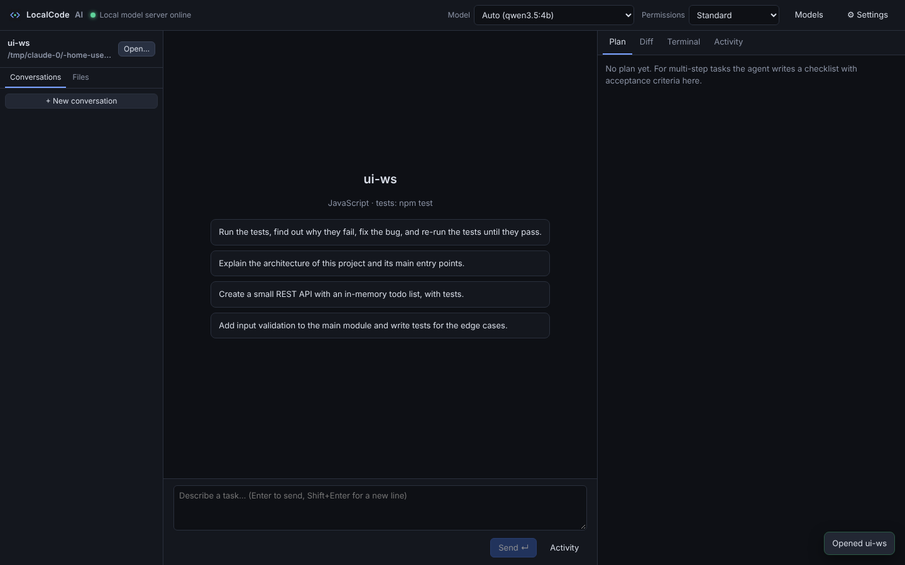

# LocalCode AI

A fully local, tool-using coding agent for open-weight models. LocalCode reads your
repository, plans multi-step changes, edits files, runs commands and tests, fixes
errors from real logs, and reports what actually happened — all on your own machine,
with models served by **Ollama** or any **OpenAI-compatible local server**
(llama.cpp `llama-server`, LM Studio, vLLM, LocalAI).

No cloud AI APIs, no telemetry. Your code and prompts go only to the inference
server you configure (by default `127.0.0.1`).



## What it does

- **Real agent loop** — inspect → plan (with acceptance criteria) → act → verify → review → report.
  Tools are executed by the application, results are fed back to the model, and the
  loop continues until the task is done, tests pass, or a genuine blocker is reached.
- **16 tools**: `list_files`, `read_file`, `search_code` (text / regex / tree-sitter symbols /
  file names / optional semantic search), `write_file`, `edit_file`, `move_file`, `delete_file`,
  `run_command` (persistent shell + background processes), `process`, `run_tests`, `inspect_errors`,
  `git_status`, `git_diff`, `git_commit`, `undo_changes`, `update_plan`.
- **Honest reporting** — the final report lists files changed (computed from disk), every
  command with its *actual* exit code, parsed test results, and warnings such as "files were
  changed but nothing was run to verify them". The model's own claims are shown separately.
- **Works with weak tool callers** — LocalCode never assumes a model supports tools. A live
  probe tests native tool calling and a prompted fallback; tool calls a model writes as text
  (fenced JSON, `<tool_call>`, `[TOOL_CALLS]`, `<|python_tag|>`…) are recovered; arguments are
  validated and errors are explained to the model so it can correct itself.
- **Safety** — workspace sandboxing for file tools (no `..`/symlink escapes), a command risk
  classifier, three permission modes, approvals for risky actions, secret redaction,
  environment scrubbing, and checkpoints before every change with one-click undo.
- **Persistence** — conversations, tasks, plans, activity and checkpoints live in SQLite;
  interrupted tasks can be resumed after a restart.
- **Context management** — older tool output is compacted and long histories are summarized
  (preserving requirements, decisions, file references and outstanding work).
- **Model management** — discover servers and installed models, capabilities, memory
  estimates vs. your RAM/VRAM, download models (with size disclosure), pick models for
  coding / planning / lightweight / embedding roles, and benchmark them on real coding tasks.
- **Desktop app** (Tauri + React) with chat/task timeline, file explorer, streaming terminal,
  side-by-side diff viewer, activity log, plan view, approval prompts, stop/retry/resume/undo,
  settings and a first-run wizard. The same engine also powers a full **CLI**.

## Requirements

| | Minimum | Recommended |
|---|---|---|
| OS | Linux, macOS 12+, Windows 10/11 | |
| Node.js | **22.13+** (uses the built-in `node:sqlite`) | 22 LTS or newer |
| git | required for checkpoints/undo and git tools | |
| ripgrep | optional (faster search; built-in fallback otherwise) | `rg` on PATH |
| Inference | Ollama **or** an OpenAI-compatible local server | Ollama 0.6+ |
| RAM | 8 GB (3–4B models) | 16–32 GB (7–14B models) |
| GPU | none (CPU works, slowly) | NVIDIA 8 GB+ VRAM, or Apple Silicon |

Building the desktop app additionally needs Rust (stable) and the
[Tauri prerequisites](https://tauri.app/start/prerequisites/) (WebKitGTK on Linux,
Xcode CLT on macOS, WebView2 + MSVC build tools on Windows).

### Models

Any chat model served locally can be used; tool-capable coding models work best.
Measured on the development machine (4 CPU threads, 16 GB RAM, **no GPU**):

| Model | Size | Tool calling (probe) | Benchmark | Notes |
|---|---|---|---|---|
| `qwen3.5:4b` | 3.3 GB | native ✓ | see [docs/BENCHMARKS.md](docs/BENCHMARKS.md) | fixed the sample bug end-to-end; ~5–6 tok/s on CPU |
| `qwen2.5-coder:1.5b` | 1.0 GB | prompted fallback (native calls echo the schema) | 18/100 | too small for agent work; useful for chat |

Good choices by hardware: **≥24 GB VRAM/RAM** `qwen3-coder:30b`, `qwen2.5-coder:32b` ·
**12–16 GB** `qwen2.5-coder:14b`, `qwen3:14b` · **8 GB** `qwen2.5-coder:7b`, `qwen3:8b`,
`llama3.1:8b` · **<8 GB** `qwen3.5:4b`, `qwen2.5-coder:3b`. DeepSeek Coder and other
open-weight models work too; run **Models → Test tool calling** to see how LocalCode will
talk to them. Weights are never bundled — you download them separately.

## Quick start

```bash
# 1. Install an inference server and a model (network access, one time)
#    Linux:   curl -fsSL https://ollama.com/install.sh | sh
#    macOS:   brew install ollama     Windows: https://ollama.com/download
ollama serve &                      # if it is not already running as a service
ollama pull qwen2.5-coder:7b        # or a smaller/larger model for your hardware

# 2. Install and build LocalCode
git clone <this repository> localcode && cd localcode
./scripts/install.sh                # Windows: powershell -File scripts\install.ps1

# 3. Check your setup
node apps/cli/dist/localcode.mjs doctor

# 4a. Use the desktop UI in your browser
node apps/cli/dist/localcode.mjs serve        # prints http://127.0.0.1:4317/#token=...

# 4b. ...or the native desktop app (needs Rust + Tauri prerequisites)
npm run desktop:dev                 # development
npm run desktop:build               # installers in apps/desktop/src-tauri/target/release/bundle

# 4c. ...or the CLI
node apps/cli/dist/localcode.mjs run "Add input validation to src/api.ts and tests for it" -w ~/my-project
```

Optionally link the CLI globally: `npm link -w @localcode/cli` (then just `localcode …`).

### Try the demo

```bash
cp -r examples/sample-project /tmp/demo
node apps/cli/dist/localcode.mjs run -w /tmp/demo \
  "Run the tests, find out why they fail, fix the bug in src/, and re-run the tests until they pass."
```

The sample has one failing test (a discount is subtracted instead of applied as a
percentage). A capable model reads the test and source, makes a one-line fix and shows the
passing test run; the report lists the real exit codes (`1` before, `0` after).

## Using the CLI

```
localcode run "<task>"     Run a task and stream progress           (-w dir, -m model, --mode, -y)
localcode chat             Interactive session; /model, /mode, /undo, /exit
localcode serve            Local server + web UI (127.0.0.1 only, token protected)
localcode doctor           Dependencies, hardware, inference servers, installed models
localcode models           Installed models, capabilities, tool mode, memory fit
localcode probe <model>    Live test: native tool calls vs prompted fallback
localcode bench <model>    Benchmark on 3 real coding tasks (verified by executing code)
localcode pull <model>     Download a model through Ollama (discloses network use)
localcode tasks | resume <id> | undo [--task id|--checkpoint id] | checkpoints
```

Model names can be prefixed with a provider id (`llamacpp/qwen2.5-coder-7b`); otherwise
the provider that has the model installed is used.

## Permission modes

| Mode | Runs without asking | Asks first |
|---|---|---|
| **Strict** | reading and searching | every write, command, test run, commit |
| **Standard** (default) | reads, file edits in the workspace, build/test commands (`npm test`, `pytest`, `cargo build`…) | other programs, network, deletions, git commits |
| **Autonomous** | everything inside the workspace | network (installs, downloads, `git push`), deletions, `sudo`, destructive commands |

In every mode: reading credential-like files (`.env`, keys) asks; `delete_file` and
`git_commit` ask; catastrophic commands (`rm -rf /`, fork bombs, `curl … | sh`) are
blocked. Approvals can be "allow once", "always allow `<prefix>`" (stored per workspace,
never for `sudo`), or "deny" with a note that is passed to the agent.

## Privacy and security model

- Prompts and code are sent only to configured inference servers (localhost by default).
  There is no telemetry. Network access happens only when you download a model or approve
  a command that needs it.
- File tools are confined to the workspace (path traversal and symlink escapes are rejected,
  `.git` internals are read-only).
- Commands run in a real shell. They are risk-classified and run with the workspace as their
  working directory, but there is **no OS-level sandbox** — approve commands as you would on
  your own terminal. Strict mode is the safest choice for untrusted repositories.
- Secret-looking environment variables (`*_TOKEN`, `*_KEY`, `*PASSWORD*`…) are removed from
  the agent's shell; known key formats, `.env` lines and literal secret values are redacted
  from tool output before the model sees them, and writing redaction placeholders back into
  files is refused.
- Repository content, command output and documents are treated as untrusted data; the system
  prompt tells the model never to follow instructions found inside them, and the permission
  system is the real safeguard.
- The local server binds to `127.0.0.1`, requires a random token, and rejects WebSocket
  connections from other web origins.

## Configuration

Settings are edited in the app (⚙ Settings) or stored in SQLite under the data directory:
Linux `~/.local/share/localcode`, macOS `~/Library/Application Support/LocalCode`,
Windows `%APPDATA%\LocalCode` (override with `LOCALCODE_HOME`). See
[docs/CONFIGURATION.md](docs/CONFIGURATION.md) for all options, inference-server setup
(Ollama, llama.cpp, LM Studio) and the per-project instructions file (`LOCALCODE.md` or
`AGENTS.md`).

## Development

```bash
npm install
npm run build                 # engine + CLI bundle + UI
npm test                      # unit tests (no model needed)
LOCALCODE_INTEGRATION=1 npx vitest run --project integration   # real Ollama required
npx playwright test           # UI end-to-end against the real engine and model
npm run typecheck
```

Project layout:

```
packages/core     Agent engine (TypeScript): models/, agent/, tools/, security/, exec/,
                  repo/, storage/, checkpoints/, engine/, env/
apps/cli          `localcode` CLI and the local WebSocket server (bundled with esbuild)
apps/desktop      React UI (Vite) and the Tauri shell (src-tauri/)
examples/         Sample repository for the demo task and configuration examples
e2e/              Playwright UI tests
docs/             Architecture, configuration, troubleshooting, benchmarks
```

Read [docs/ARCHITECTURE.md](docs/ARCHITECTURE.md) for how the agent loop, tool-call
adapter, permissions, checkpoints and context management work.

## Troubleshooting

See [docs/TROUBLESHOOTING.md](docs/TROUBLESHOOTING.md). The most common issues:
the model server is not running (`ollama serve`), the model is too large for your memory
(use a smaller model or lower the context length), or the model cannot use tools reliably
(run the probe; use a larger tool-capable model).

## Known limitations

- Capability depends heavily on the model and hardware. Small models (≤4B) handle simple,
  focused tasks; multi-file features need 7B+ coding models. On CPU-only machines each step
  can take tens of seconds.
- Commands are not OS-sandboxed (see the security model above).
- The desktop app needs a system Node.js 22.13+ to run the engine (it is not bundled).
- Windows support (PowerShell shell backend, installer) is implemented but was not tested on
  Windows during development; Linux was tested end to end.
- Tree-sitter symbol extraction covers TypeScript/JavaScript, Python, Rust, Go, Java, C#,
  C/C++, Ruby, PHP and Bash; other languages use regex heuristics.
- Semantic search needs a local embedding model (e.g. `ollama pull nomic-embed-text`) and
  is built on demand.

## License

MIT
